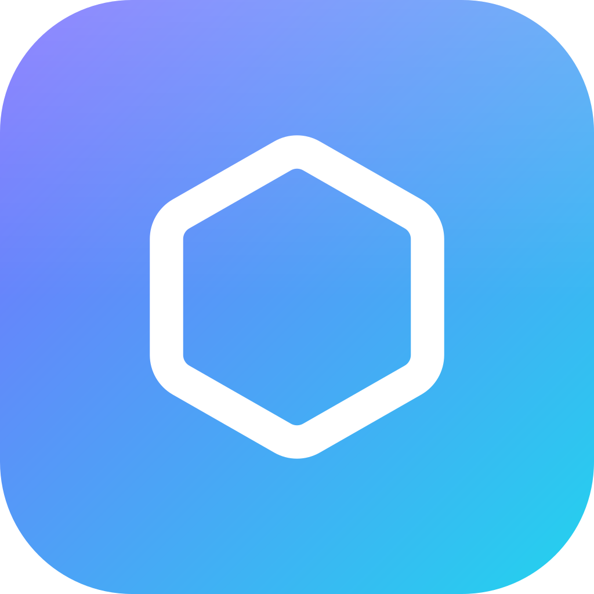
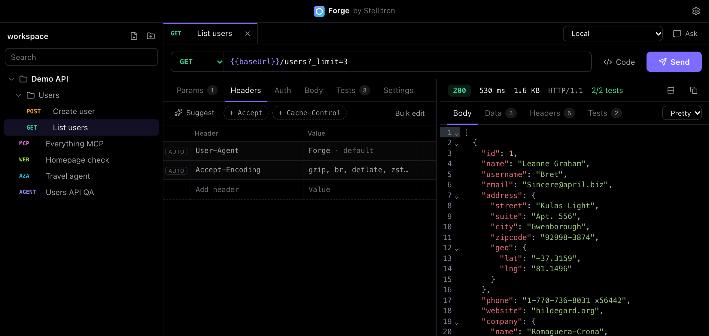

<div align="center">



# Forge

**One local-first client for every API you test.**

REST, GraphQL, WebSocket, MCP servers, A2A agents and websites, in one fast desktop app.
No account, no cloud, no telemetry. Your work is plain files in a folder you choose.

[Download](https://forge.stellitron.com) ·
[Documentation](docs/README.md) ·
[Releases](https://github.com/stellitron/forge/releases) ·
[Report a bug](https://github.com/stellitron/forge/issues/new/choose)

[](LICENSE)
[](https://github.com/stellitron/forge/actions/workflows/ci.yml)
[](https://github.com/stellitron/forge/releases/latest)



</div>

## Why Forge

- **Local first.** Collections and environments are small JSON files you can review and share through git. Nothing leaves your computer unless you send a request.
- **Every protocol in one place.** HTTP and GraphQL, WebSocket, MCP (stdio, Streamable HTTP, SSE), A2A agents and website checks.
- **Secrets stay secret.** Tokens live in `*.local.json` files that Forge keeps out of git. Typing a real token into a request gets a warning and a one-click fix.
- **Optional AI.** Bring your own model (Claude, OpenAI, Gemini, Azure, Bedrock, OpenRouter or a local Ollama) for questions, test generation and agentic testing. Everything else works without it.
- **Free and open source** under the Apache License 2.0, made by [Stellitron](https://stellitron.com).

## Features

| Area | What you get |
| --- | --- |
| **HTTP and GraphQL** | Params synced with the URL, path variables, headers with autocomplete, JSON, XML, form, multipart and file bodies, cookies, redirects, timing |
| **Auth** | Bearer, Basic, API key, OAuth 2.0 (authorization code with PKCE, client credentials, password, automatic refresh), AWS Signature v4, Digest, Hawk, JWT, and client certificates for mutual TLS |
| **Tests and runner** | Assertions on status, JSONPath, headers, body, time and size, one-click suggestions from a response, captured variables, folder runs with iterations |
| **CI** | A command-line runner for GitHub Actions and other CI: environments, secrets from CI, data files, JUnit and JSON reports |
| **Response data** | A Data tab that turns JSON into sortable tables, plus exports to PDF, Word, PowerPoint, Excel, CSV and Markdown, built without AI |
| **MCP** | Connect over stdio, Streamable HTTP or SSE. Browse and call tools, read resources, get prompts, send raw JSON-RPC |
| **A2A** | Discover agent cards, chat with `message/send` or streaming `message/stream`, inspect raw events |
| **WebSocket** | Custom headers and a send and receive log |
| **Web checks** | Status, TTFB, compression, caching, security headers, cookie flags, mixed content, SEO basics, broken links |
| **Import** | Postman, Insomnia, Bruno, OpenAPI and Swagger, HAR and cURL, detected automatically. Paste a `curl` command into any URL bar |
| **API docs** | A searchable web page or Markdown file built from your requests and last responses, with optional AI-drafted descriptions you review first |
| **Export** | Collections to Postman v2.1 or OpenAPI 3.0, environments to Postman, responses to Excel, PDF, Word, PowerPoint, CSV or Markdown |
| **Code generation** | cURL, fetch, axios, Python, Go, Java, C#, PHP, Ruby, Rust, HTTPie and PowerShell |
| **Ask** | Chat about your APIs. Explains responses, writes client code, builds reports, organizes your collections |
| **Agentic testing** | An AI agent explores an API, MCP server or A2A agent, runs tests and writes a report with evidence |
| **Forge as a server** | Let Claude, Copilot, Cursor and other assistants run your saved requests over MCP or A2A |
| **Updates** | Signed over-the-air updates. Nothing installs without your click |

## Install

Download the latest version for macOS, Windows or Linux from **[forge.stellitron.com](https://forge.stellitron.com)** or the [releases page](https://github.com/stellitron/forge/releases/latest). Forge updates itself after that.

New to Forge? Read [Getting started](docs/getting-started.md).

## How it works

```
 ┌──────────────── Forge desktop app ────────────────┐
 │  React UI   ── requests, tests, AI chat ──┐       │
 │                                           ▼       │
 │  Rust core: HTTP engine, MCP and WebSocket        │        Your APIs,
 │  clients, workspace file store, local MCP and  ───┼──────▶ MCP servers
 │  A2A server on 127.0.0.1                          │        and agents
 └───────────────────────┬───────────────────────────┘
                         │ reads and writes
                         ▼
        my-workspace/                (a folder you pick, commit it to git)
          collections/**.json        requests, MCP servers, agents
          environments/dev.json      shared variables
          environments/dev.local.json   secrets, never committed
```

The UI and the Rust core run on your computer. Requests go straight from Forge to the APIs you test. If you connect an AI provider, the parts of a conversation it needs go to that provider under your own account, and environment variable values are never sent. See [How Forge works](docs/how-it-works.md) for the details.

## Documentation

| Guide | For |
| --- | --- |
| [Getting started](docs/getting-started.md) | Installing, your first workspace, request and test |
| [Editing requests](docs/requests.md) | Params, headers, auth, bodies, variables, tests, data and reports |
| [Workspace format](docs/workspace-format.md) | The files Forge writes and how to share them |
| [Command-line runner](docs/cli.md) | Running your requests and tests in CI or a terminal |
| [AI features](docs/ai.md) | Providers, Ask, agentic testing and privacy |
| [Connect AI tools](docs/connect-ai-tools.md) | Using Forge from Claude, Copilot, Cursor and A2A clients |
| [Security model](docs/security.md) | How secrets and AI-built requests are protected |
| [Updates](docs/updates.md) | How over-the-air updates work and stay safe |
| [How Forge works](docs/how-it-works.md) | Architecture for contributors |
| [Development](docs/development.md) | Building, testing and project layout |
| [Releasing](docs/releasing.md) | Maintainer release checklist |

## Build from source

Requires Node.js 20 or newer and Rust 1.88 or newer, plus the [Tauri prerequisites](https://tauri.app/start/prerequisites/) for your platform.

```bash
git clone https://github.com/stellitron/forge.git
cd forge
npm install
npm run app        # desktop app with hot reload
npm test           # TypeScript and Rust tests
npm run package    # installers in src-tauri/target/release/bundle
```

`npm run dev` opens a browser preview with a demo workspace, handy for UI work. More in [Development](docs/development.md).

## Contributing

Bug reports, ideas and pull requests are welcome. Please read [CONTRIBUTING.md](CONTRIBUTING.md) and our [Code of Conduct](CODE_OF_CONDUCT.md). To report a security issue privately, see [SECURITY.md](SECURITY.md).

## License

Copyright 2026 Stellitron Technologies Pvt Ltd. Licensed under the [Apache License, Version 2.0](LICENSE).

Forge and the Forge logo are trademarks of Stellitron. You may use, modify and distribute the code under the license, but forks must use a different name and logo. See [NOTICE](NOTICE).
