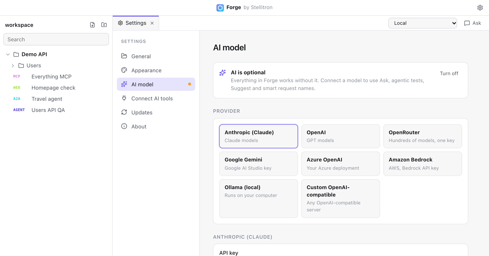

# AI features

AI in Forge is optional. Every feature that sends requests, runs tests, imports, exports or builds reports works without it. When you connect a model, you also get:

- **Ask** (<kbd>⌘</kbd> <kbd>L</kbd>): questions about your requests and responses, client code, reports and tidying up collections.
- **Suggest** on the Params and Headers tabs.
- **Smart request names**, polished once after a new request's first response.
- **Agentic tests**: an agent that explores an API, MCP server or A2A agent and writes a test report.
- **A2A replies** when other agents talk to Forge (see [Connect AI tools](connect-ai-tools.md)).

## Connect a model

Open **Settings, AI model**, pick a provider, paste your key and choose a model. Nothing is chosen for you.

| Provider | Endpoint (default) | Model |
| --- | --- | --- |
| Anthropic | `https://api.anthropic.com` | for example `claude-opus-5-5` |
| OpenAI | `https://api.openai.com/v1` | any chat model with tool calling |
| OpenRouter | `https://openrouter.ai/api/v1` | for example `anthropic/claude-haiku-5.5` |
| Google Gemini | `https://generativelanguage.googleapis.com/v1beta/openai` | for example `gemini-2.5-flash`, with an AI Studio key |
| Azure OpenAI | your resource, like `https://my-resource.openai.azure.com` | your deployment name. The key is sent as `api-key` |
| Amazon Bedrock | `https://bedrock-runtime.<region>.amazonaws.com` | a model or inference profile ID, with a Bedrock API key |
| Ollama | `http://localhost:11434/v1` | a local model, for example `qwen3:14b` |
| Custom | any OpenAI-compatible URL | your model name |

The model must support tool calling for Ask and agentic tests. Leave the endpoint empty to use the default, or set it to use a company gateway or proxy.

Your key is stored in Forge's app settings on your computer (see [Workspace format](workspace-format.md#settings-outside-the-workspace)), never in the workspace.

## What is sent to the provider

Forge talks to the provider directly with your key. Stellitron never sees your prompts, data or keys.

| Sent | Never sent |
| --- | --- |
| Your message and the conversation so far | Environment variable values and secrets |
| Requests and responses that the assistant decides to read | Your API key to anyone except the provider |
| Names of requests, folders and environments | Anything, if you don't connect a model |
| For Suggest: method, URL path and field names | For Suggest: query values, header values, bodies |

Variables reach the model as `{{name}}` placeholders. Forge fills in the values locally when it sends a request. With Ollama, everything stays on your machine.

If your company provides the model through its own endpoint, the company's agreement with that provider applies. Forge itself is a free, open source client and adds no data collection of its own.

## Ask

Ask is Forge's assistant for your workspace. Open it with the **Ask** button or <kbd>⌘</kbd> <kbd>L</kbd>. It always knows which request you have open.

To ask about other requests, type `@` and pick one, or drag a request from the sidebar onto the Ask panel. Each one shows as a chip above the message; press <kbd>↵</kbd> with no text for an explanation of it. Ask only receives each request's name, method and URL as written (with `{{placeholders}}`), and reads the rest through the same tools as everything else, so secret values stay out.

Ask can read your collections, run saved requests, look at the last response, and work with response data through exact tools rather than by reading raw bodies:

- `response_data` summarises the structure of a response.
- `query_data` filters, sorts, groups and aggregates with exact results.
- `create_report` writes PDF, Word, PowerPoint, Excel, CSV or Markdown reports.
- `create_folder` and `organize` tidy up collections, after you approve.

Each step shows in the chat with a plain description, and you can expand it to see the input and result.

## Agentic tests

Create an **Agent test** from the sidebar menu, describe the goal, and point it at a base URL, an OpenAPI URL, an MCP server or an A2A agent from your collections.

- By default the agent asks before any request that changes data and before MCP tools that are not read-only.
- Every request the agent made can be saved into your collection with one click.
- The report lists each test, the findings with evidence, and token use.

## Protections

AI-built requests pass through the same secret guard as connected tools. A request needs your approval if it goes to a host none of your saved requests use, or if it would send a secret to a host that doesn't normally receive it. See [Security model](security.md).
