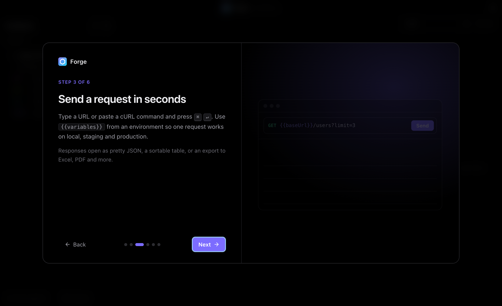

# Getting started

This guide takes you from download to a tested request in about five minutes.

## 1. Install

Download Forge from [forge.stellitron.com](https://forge.stellitron.com) or the [latest release](https://github.com/stellitron/forge/releases/latest).

| System | File | Notes |
| --- | --- | --- |
| macOS (Apple silicon or Intel) | `.dmg` | Open it and drag Forge to Applications. |
| Windows 10 and 11 | `-setup.exe` or `.msi` | Run the installer. |
| Linux | `.AppImage`, `.deb` or `.rpm` | For the AppImage, run `chmod +x Forge*.AppImage` first. |

After this, Forge updates itself. See [Updates](updates.md).

## 2. Take the tour

The first time you open Forge, a short guide explains the main ideas. You can skip it and bring it back from **Settings, General, Welcome guide**.

## 3. Choose a workspace

A workspace is any folder. Forge stores each request and environment there as a small JSON file. Pick an empty folder for a new project, or a folder inside an existing git repository so your API requests live next to your code.

You can switch workspaces any time in **Settings, General**.

## 4. Send your first request

1. Right-click the collection in the sidebar and choose **New request**.
2. Type a URL, for example `https://jsonplaceholder.typicode.com/users?_limit=3`. The query parameters appear in the **Params** tab automatically.
3. Press **Send** or <kbd>⌘</kbd> <kbd>↵</kbd> (<kbd>Ctrl</kbd> <kbd>↵</kbd> on Windows and Linux).

The response opens on the right. Switch to **Data** to see it as a table, or export it.

Tip: paste a whole `curl ...` command into the URL bar to import it.

## 5. Use an environment

Environments hold values that change between local, staging and production.

1. Choose **Environments** at the bottom of the sidebar, then **New environment**.
2. Add `baseUrl` with a value like `https://jsonplaceholder.typicode.com`.
3. Add secrets such as `token` in the **Secrets** table. They are saved in a `.local.json` file that is never committed.
4. Choose the environment in the top right, and write `{{baseUrl}}/users` in your request.

Known variables are coloured in the URL. Unknown ones get a red underline.

## 6. Add a test

Open the **Tests** tab of a request after sending it. Choose **Suggest from response** to add checks in one click, or add your own, for example: status equals `200`, or JSONPath `$.length` equals `3`.

To run a whole folder, right-click it and choose **Run folder**.

## 7. Import what you have

Press <kbd>⌘</kbd> <kbd>I</kbd> or use the import button in the sidebar. Forge detects Postman, Insomnia, Bruno, OpenAPI, Swagger, HAR and cURL files automatically. Credentials found in imported environments go to the local secrets file.

Before and after importing, Forge shows a summary: how many requests, folders and environments, the methods, auth types and bodies used, and anything to check, such as missing URLs, credentials typed into requests, variables no environment defines, or Postman scripts that weren't imported. From there, **Write docs** opens [API documentation](requests.md#api-documentation) for the new collection.

## 8. Optional: connect an AI model

Go to **Settings, AI model**, pick a provider and paste your key. This turns on Ask (<kbd>⌘</kbd> <kbd>L</kbd>), the **Suggest** buttons, smart request names and agentic tests. Read [AI features](ai.md) to see what is sent.

## Keyboard shortcuts

| Shortcut | Action |
| --- | --- |
| <kbd>⌘</kbd> <kbd>↵</kbd> | Send the request |
| <kbd>⌘</kbd> <kbd>L</kbd> | Open Ask |
| <kbd>⌘</kbd> <kbd>I</kbd> | Import |
| <kbd>⌘</kbd> <kbd>J</kbd> | Console with every request and message |
| <kbd>⌘</kbd> <kbd>,</kbd> | Settings |
| <kbd>⌘</kbd> <kbd>W</kbd> | Close the tab |

Use <kbd>Ctrl</kbd> instead of <kbd>⌘</kbd> on Windows and Linux.

## Troubleshooting

**Requests fail on a company network.** Forge uses your system proxy settings and trusted certificates. If your company inspects TLS traffic, make sure its root certificate is installed in the system store. For a self-signed test server, turn off certificate checks in the request's **Settings** tab.

**macOS says Forge can't be opened.** Download it again from the official site or releases page. Official builds are signed and notarized by Stellitron.

**Something else.** Check the console (<kbd>⌘</kbd> <kbd>J</kbd>) for the full request and error, then [open an issue](https://github.com/stellitron/forge/issues/new/choose).
