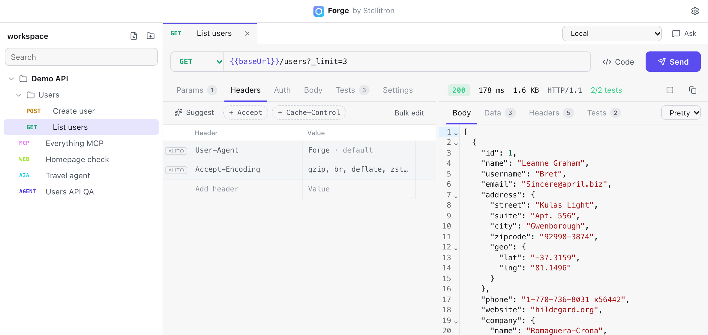
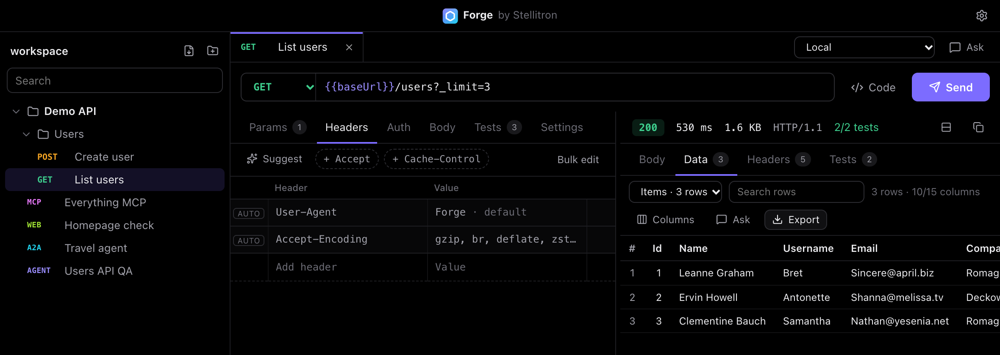

# Editing requests

## URL and params

The URL bar and the **Params** table are two views of the same query string. Type `?page=1&limit=20` in the URL or add rows in the table, and the other updates.

- Turn a row off with its checkbox to keep it without sending it.
- Write `/:id` in the path to get a **Path variables** table. The values are encoded when sent, so `a/b c` becomes `a%2Fb%20c`.

### Special characters

The table shows readable values. In the URL, Forge encodes only what would break the query.

| You type in the table | URL shows | Server receives |
| --- | --- | --- |
| `rock & roll #1` | `rock%20%26%20roll%20%231` | `rock & roll #1` |
| key `a=b` | `a%3Db` | key `a=b` |
| `100%` | `100%25` | `100%` |
| `+05:30` | `+05:30` | usually ` 05:30` (see below) |

Most servers read a `+` in a query as a space. Forge sends the `+` you typed as it is, because some APIs depend on that, and shows a warning with a one-click change to `%2B` for a literal plus.

Values from `{{variables}}` are always fully encoded, so a token like `ab+c/d==` arrives exactly as stored. A variable used on its own, like `?{{query}}`, is inserted as is, for variables that hold a whole query string.

## Headers

- Common header names and values autocomplete as you type.
- Quick chips add frequent headers such as `Accept: application/json` or `X-Request-ID: {{$uuid}}`.
- **Auto** rows show the headers Forge adds for you: `Authorization` from the Auth tab, `Content-Type` from the Body tab, `User-Agent` and `Accept-Encoding`. Add your own row with the same name to replace one.

## Bulk edit

Every table has **Bulk edit**, which turns it into text with one `key: value` per line. Start a line with `//` to turn it off. You can paste a block of headers copied from browser dev tools, or a query string like `a=1&b=2`.

## Suggest

With an AI model connected, **Suggest** proposes likely params or headers as a checklist with a reason for each. Nothing is added until you tick items and choose **Add**. Only the method, URL path and field names are sent, never values.

## Auth

Choose **Bearer token**, **Basic** or **API key**. A preview shows exactly what will be sent.

If you type a real token instead of a `{{variable}}`, Forge warns that it would be saved in the request file and shared through git. **Move to {{token}}** saves it in the active environment's secrets and puts the placeholder in its place.

## Body

The Body tab label shows the current type, such as **Body · JSON**. Supported types are JSON, text, XML, form URL-encoded, multipart (with files), GraphQL and a raw file.

## Variables

Write `{{name}}` anywhere: URL, params, headers, auth and body. Values come from the active environment, with secrets overriding shared values of the same name. Built-in variables:

| Variable | Value |
| --- | --- |
| `{{$uuid}}` | A random UUID |
| `{{$timestamp}}` | Unix time in seconds |
| `{{$isoTimestamp}}` | ISO 8601 time |
| `{{$randomInt}}` | A number from 0 to 999 |
| `{{$randomEmail}}` | A random email address |

Hover a variable to see where its value comes from. Secret values are never shown.

## Tests and captured values

The **Tests** tab holds assertions on status, headers, JSONPath, body text, response time and size. **Suggest from response** creates sensible ones from the last response.

Captures copy a value from a response into a variable, for example a login token from `$.access_token`. Captured values are stored as secrets of the active environment.

## Data and reports

JSON responses get a **Data** tab. Forge works out the structure itself, without AI. Lists become tables, nested objects become columns, and child lists become linked tables. You can search, sort and choose columns.

**Export** creates PDF, Word, PowerPoint (with charts), Excel, CSV or Markdown files in the workspace `reports/` folder, or anywhere with **Save as**. The numbers come straight from the data.

## Code

**Code** turns the request into cURL, fetch, axios, Python, Go, Java, C#, PHP, Ruby, Rust, HTTPie or PowerShell. Variables stay as `{{placeholders}}` unless you choose to fill them in.
